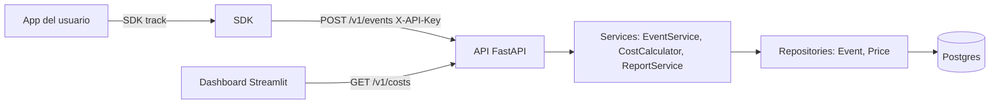

# 02 · Technical Requirements Document (TRD) — TokenLedger

## Plataformas
Servicio web (API REST) + librería Python (SDK) + dashboard web. Sin apps móviles.

## Frontend y hosting
- **Dashboard:** Streamlit (Python), servicio propio en Docker.
- **Hosting:** contenedores Docker en una plataforma con Postgres gestionado. Candidatos a evaluar en el Paso 12: Render, Fly.io, Railway. Verificar planes y límites actuales antes de decidir.

## Backend y base de datos
- Python 3.12, FastAPI, Pydantic v2, SQLAlchemy 2, Alembic.
- Postgres 16 (o la versión estable vigente en la plataforma). Una sola base, un solo esquema.
- Región: la más cercana a ti y al proveedor de despliegue; no es crítico en v0.1.

## Autenticación y roles
- Una sola API key por despliegue, enviada en el header `X-API-Key`.
- Comparación en tiempo constante (`hmac.compare_digest`) contra la variable de entorno `API_KEY`.
- Un solo rol (cliente de la API). Sin usuarios, sesiones ni OAuth en v0.1.
- `/health` es público.

## Servicios externos y APIs
| Proveedor | Propósito | Límites / notas | Dueño de credenciales |
|---|---|---|---|
| Anthropic y OpenAI | Solo se **leen** sus respuestas en el SDK para extraer `usage`; TokenLedger **no** las llama | El usuario del SDK usa sus propias claves; TokenLedger nunca las ve ni las guarda | Usuario del SDK |
| GitHub Actions | CI | Minutos según el plan | Tú |
| Plataforma de despliegue | Hosting | Por decidir | Tú |

## Arquitectura

- **Capas:** `api → services → repositories → db`. Dependencias en un solo sentido.
- **Patrones:** Repository (acceso a datos aislado), Strategy (cálculo por proveedor), Dependency Injection (`Depends`).
- **Flujo de ingesta:** SDK mide y envía en un hilo aparte → API valida → servicio busca precio vigente → calcula con `Decimal` → repositorio guarda → 201.
- **Flujo de lectura:** Dashboard → `GET /v1/costs` → servicio → repositorio agrega en SQL → JSON.

## Seguridad y privacidad
- **Datos sensibles:** ninguno de contenido. **No se guardan prompts ni respuestas**, solo proveedor, modelo, tokens, latencia, etiquetas y costo. Es una decisión de diseño y debe quedar escrita en el README.
- `customer` puede ser un identificador interno; recomendar al usuario no enviar correos ni datos personales (usar IDs opacos).
- Secretos solo por variables de entorno; `.env` en `.gitignore`; `.env.example` sin valores reales.
- Validación estricta de entrada con Pydantic; consultas siempre parametrizadas (SQLAlchemy).
- Riesgo conocido en v0.1: sin límite de peticiones (rate limiting). Mitigación: despliegue público solo con datos sintéticos y API key obligatoria.

## Metas de rendimiento y fiabilidad
- `POST /v1/events` p95 < 150 ms; `GET /v1/costs` < 500 ms con 100 000 eventos (medir con el script de demo ampliado).
- Disponibilidad: sin objetivo formal en v0.1 (proyecto de portafolio).
- Respaldo: el que ofrezca el Postgres gestionado; documentar cómo restaurar en `docs/DEPLOY.md`.
- SDK: timeout de red corto (≈2 s), envío en segundo plano, cero excepciones hacia el usuario.

## Entornos y entrega
| Entorno | Cómo | Notas |
|---|---|---|
| Desarrollo | `docker compose up` | API, Postgres y dashboard locales |
| CI | GitHub Actions | ruff, formato, pytest con Postgres de servicio, cobertura ≥ 80% |
| Producción | Contenedores en la plataforma elegida | Migraciones con `alembic upgrade head` al iniciar |
No hay *staging* en v0.1 (decisión: costo y complejidad no justificados).
Rollback: volver a la imagen anterior; las migraciones se escriben compatibles hacia atrás cuando sea posible.

## Decisiones técnicas y compromisos
| Decisión | Razón | Alternativa descartada |
|---|---|---|
| Monolito modular | Un equipo de una persona; menos piezas que operar | Microservicios (complejidad sin beneficio) |
| `Decimal` y `numeric(14,8)` para dinero | Evita errores de redondeo de `float` | `float` |
| Precios en BD, cargados desde YAML | Cambian con frecuencia; no deben requerir despliegue | Precios en el código |
| Costo calculado en el servidor | El cliente no puede falsear ni equivocarse | Costo enviado por el SDK |
| SDK que nunca lanza excepciones | Una herramienta de observabilidad no puede tumbar la app | SDK estricto |
| Postgres desde el inicio | Misma base en local y producción | SQLite (diferencias de comportamiento) |
| Streamlit para el dashboard | Una sola persona y un solo lenguaje; rápido | React (más tiempo, fuera del objetivo) |
| API key única | Suficiente para v0.1 | OAuth/usuarios (v0.2+) |
