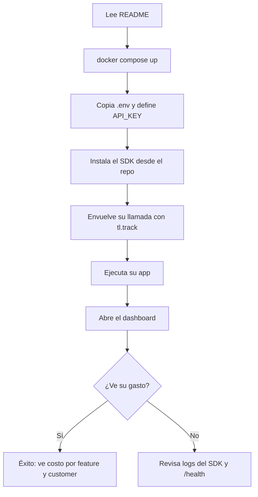

# 03 · App Flow — TokenLedger

TokenLedger tiene dos recorridos: el del **desarrollador** (integrar) y el de quien **mira el dashboard**.

## Puntos de entrada
- README del repo (desarrollador que llega desde GitHub o el portafolio).
- URL pública del dashboard de demostración.
- Llamada directa a la API (integraciones propias).

## Inventario de pantallas
| Pantalla | Propósito | Datos requeridos |
|---|---|---|
| **Dashboard** (única) | Ver el gasto por función y cliente | `GET /v1/costs` (feature y customer), rango de fechas |
| Docs de la API (`/docs`, Swagger generado por FastAPI) | Probar endpoints | Ninguno |
| Salida de CLI/logs del SDK | Confirmar que los eventos se envían | Logs del SDK |

## Recorrido principal (desarrollador)

## Recorrido secundario (quien mira el dashboard)
Abre la URL → ve el rango por defecto (últimos 14 días) → cambia fechas → ve barras por feature y por customer → lee la tabla de totales.

## Recorridos alternos
- **Cambiar el rango de fechas:** el dashboard recarga datos.
- **Sin datos:** mensaje guía con el comando del generador de datos de demo.
- **API caída:** mensaje de error amable con botón "Reintentar".
- **API key mala en el dashboard:** mensaje que indica revisar `API_KEY`, sin mostrar el valor.

## Acciones (disparador, validación, carga, éxito, error, siguiente)
| Acción | Disparador | Validación | Carga | Éxito | Error | Siguiente |
|---|---|---|---|---|---|---|
| Registrar evento (SDK → API) | `tl.track(...)` | Esquema Pydantic: tokens ≥ 0, feature requerido, modelo con precio | Ninguna visible; envío en segundo plano | 201 con `cost_usd` | 401 / 422 / red caída: warning en logs, la app del usuario sigue | La app continúa |
| Consultar costos | Abrir dashboard o cambiar fecha | `group_by` válido; `from` ≤ `to` | Spinner de Streamlit | Gráficos y tabla | 401 / 422 / sin conexión: mensaje en pantalla | Mismo dashboard |
| Comprobar salud | `GET /health` | Ninguna | n/a | `{"status":"ok"}` | n/a | n/a |

## Reglas de navegación
- Una sola pantalla; no hay pestañas ni *deep links* en v0.1.
- Los parámetros de fecha viven en el estado de la sesión de Streamlit (no en la URL).

## Estados vacíos y bloqueados
| Estado | Qué ve el usuario |
|---|---|
| Sin datos | "Aún no hay eventos. Ejecuta `uv run python -m scripts.seed_demo` o envía uno con el SDK." |
| API caída o sin red | "No se pudo conectar con la API." + botón Reintentar |
| 401 | "La API rechazó las credenciales. Revisa `API_KEY`." |
| Rango sin datos | Tablas vacías con aviso "Sin gasto en este rango" |

## Primer uso (onboarding)
No hay cuentas. El onboarding es el README: 3 comandos (`cp .env.example .env`, `docker compose up`, `uv run python -m scripts.seed_demo`) y un ejemplo de 5 líneas con el SDK.
